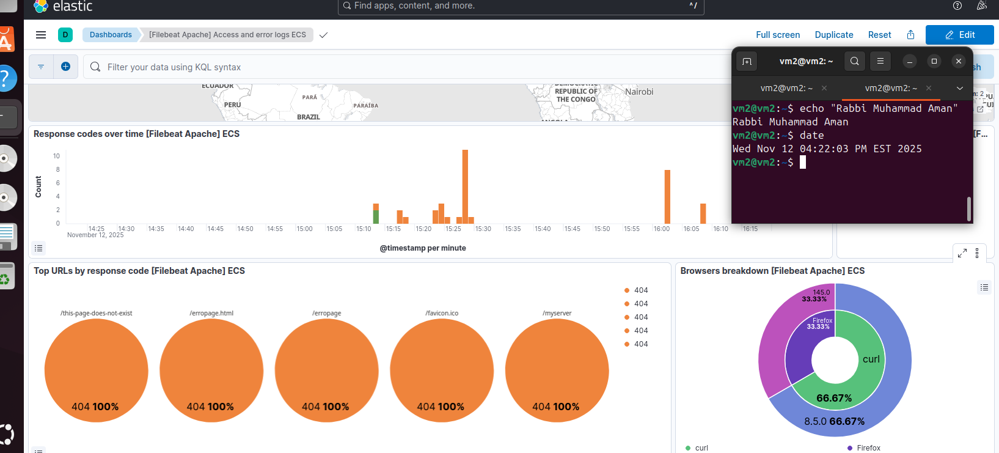
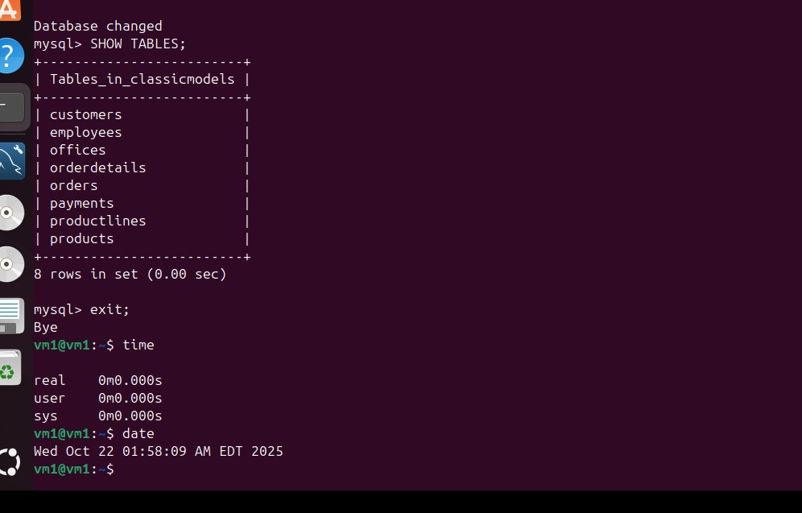

# 🗄️ RIS330 — Databases, Security and Data Analytics

**SQL design, backup and recovery, NoSQL, centralized logging with ELK, and NLP**

---

## 📌 Overview

Coursework from **RIS330 (Fall 2025, Seneca Polytechnic)**. The course covers data management with a security focus: designing sound schemas, protecting data with tested backups, working with NoSQL, centralizing logs for monitoring, and processing text with NLP.

## 🔬 Work

| # | Title | Highlights | Report |
|---|---|---|---|
| A1 | **Relational database design and SQL** | ER diagram, DDL with PK/FK/unique constraints, DML, `ON DELETE CASCADE` demonstration | [Open](assignment01-sql-database/README.md) |
| A3 | **Centralized logging with the ELK stack** | Elasticsearch, Logstash, Kibana and Filebeat on Ubuntu; Apache access and error logs ingested and visualized | [Open](assignment03-elk-stack/README.md) |
| L5 | **Backup and recovery** | `mysqldump`, Workbench export/import, and **point-in-time recovery from MySQL binary logs** | [Open](lab05-backup-recovery/README.md) |
| L7 | **NoSQL with MongoDB** | JSON import, filter, projection and count queries on a movie dataset | [Open](lab07-mongodb-nosql/README.md) |
| L8 | **NLP with spaCy** | Interactive Python tool: tokenization, POS tagging, dependency parsing, lemmatization, NER | [Open](lab08-nlp-spacy/README.md) |

## 🖼️ Preview

| ER diagram | Kibana | Binary-log recovery |
|---|---|---|
|  |  |  |

## 🧰 Tools and skills

`MySQL` · `MySQL Workbench` · `SQL (DDL/DML)` · `MongoDB` · `Elasticsearch` · `Logstash` · `Kibana` · `Filebeat` · `Python` · `spaCy` · `Backup and disaster recovery`

---

Author: <b>Rabbi Muhammad Aman</b> · Academic coursework.
