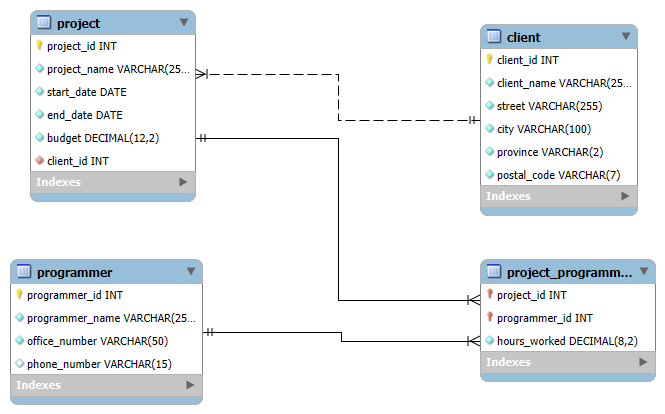
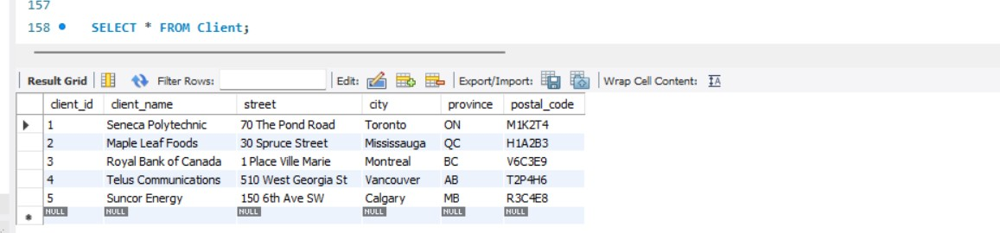
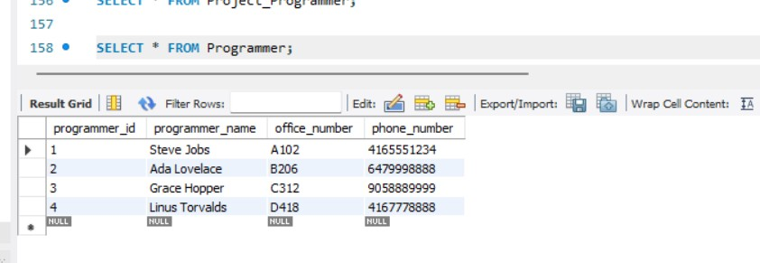
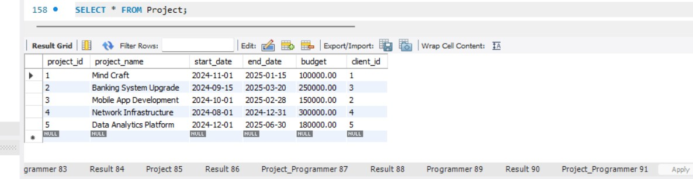
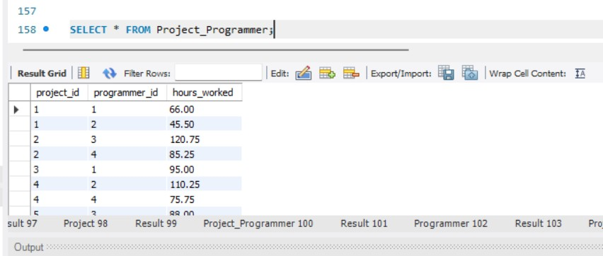
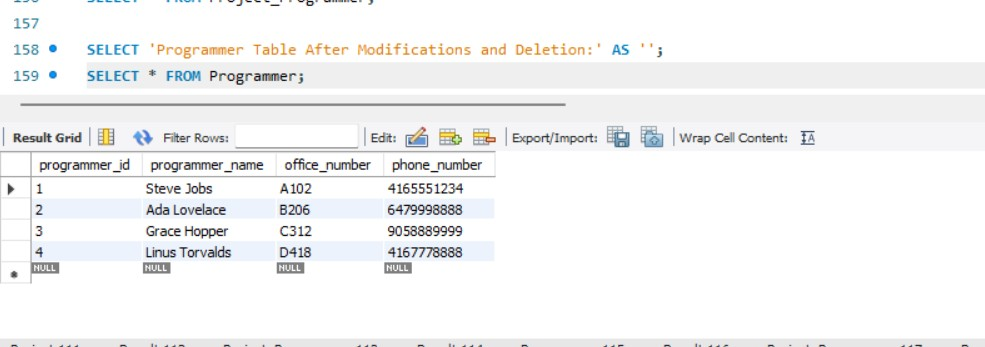
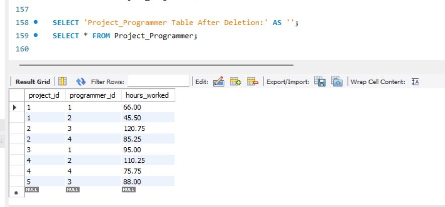

# Assignment 1 — Relational Database Design and SQL

**Author:** Rabbi Muhammad Aman · **Course:** RIS330 (Fall 2025)

## Objective

Design and build a relational database for a software consulting company (`seneca_code_inc`): an ER diagram, then DDL with primary/foreign keys and constraints, DML to load data, and modifications that demonstrate `ON DELETE CASCADE`.

## Part 1 — Entity relationship diagram

*ER diagram: Client, Programmer, Project and the Project_Programmer associative entity*

## Part 3 — Tables populated

*Client table*

*Programmer table*

*Project table*

*Project_Programmer table*

## Part 4 — Modifications and cascading delete

*Programmer table after updates and deletion*

*Project_Programmer after deletion, showing the cascade*

The complete DDL and DML script is in [`ddl_and_dml.sql`](ddl_and_dml.sql).

## Key takeaways

- Primary, foreign and unique key constraints enforce integrity in the schema itself.
- Associative entities resolve many-to-many relationships.
- `ON DELETE CASCADE` keeps child rows consistent, and has to be used deliberately.
