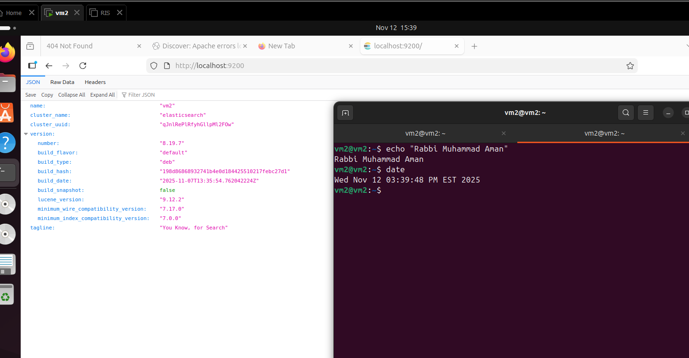
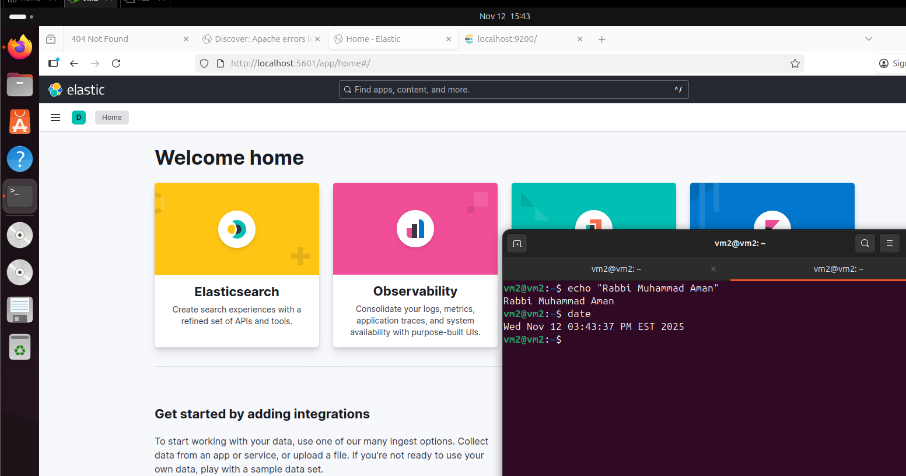
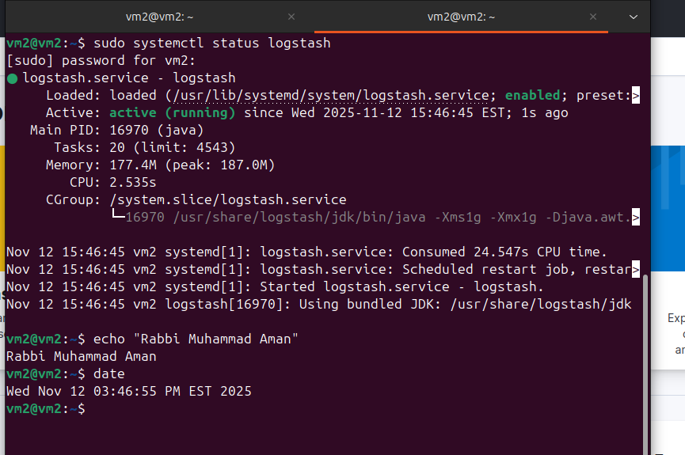
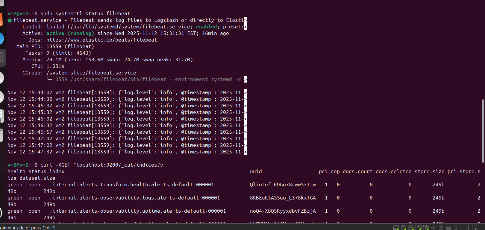
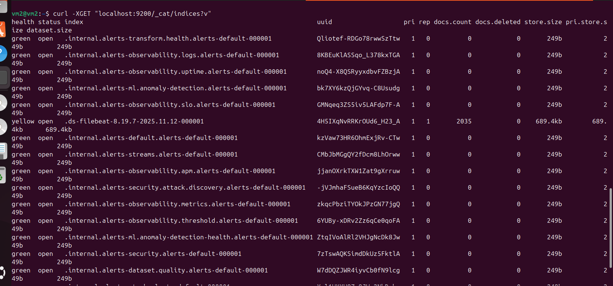
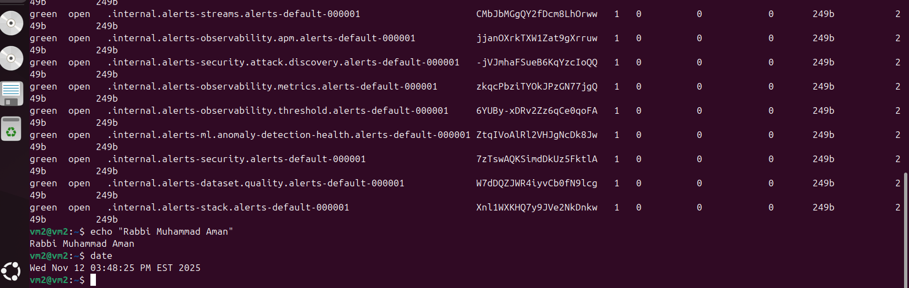
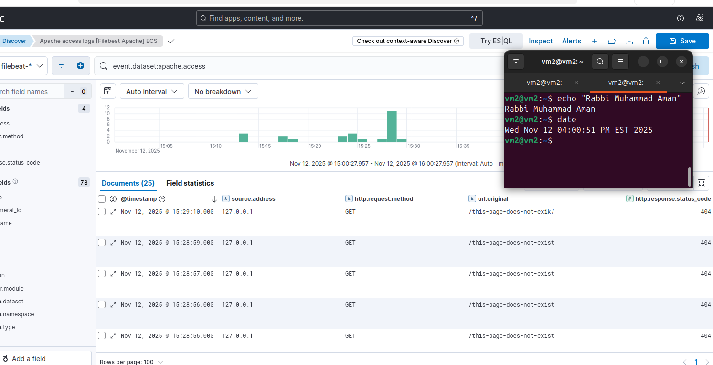
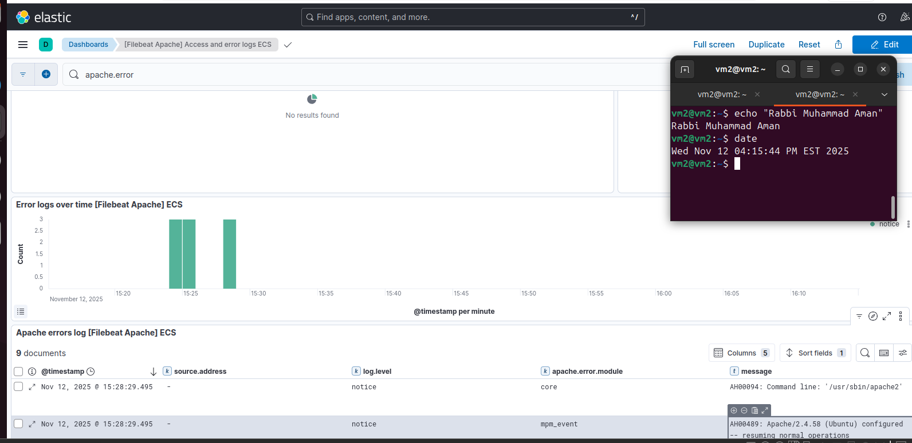

# Assignment 3 — Centralized Logging with the ELK Stack

**Author:** Rabbi Muhammad Aman · **Course:** RIS330 (Fall 2025)

## Objective

Deploy Elasticsearch, Logstash, Kibana and Filebeat on Ubuntu, ship Apache access and error logs into Elasticsearch, and build Kibana visualizations.

## Stack running

*Elasticsearch running*

*Kibana running*

*Logstash running*

*Filebeat running*

## Verifying ingestion

*Elasticsearch indices receiving Filebeat data*

*Index details*

## Data analysis and visualization

*Apache access logs in Kibana Discover*

*Apache error logs*

*Kibana visualization dashboard*

References: DigitalOcean's *How to install the Elastic Stack on Ubuntu 22.04*; FOSS TechNix's *Send Apache2 logs to Elastic Stack with Filebeat*.

## Key takeaways

- Central log aggregation is the foundation of SIEM and incident response.
- Filebeat → (Logstash) → Elasticsearch → Kibana separates collection, parsing, storage and visualization.
