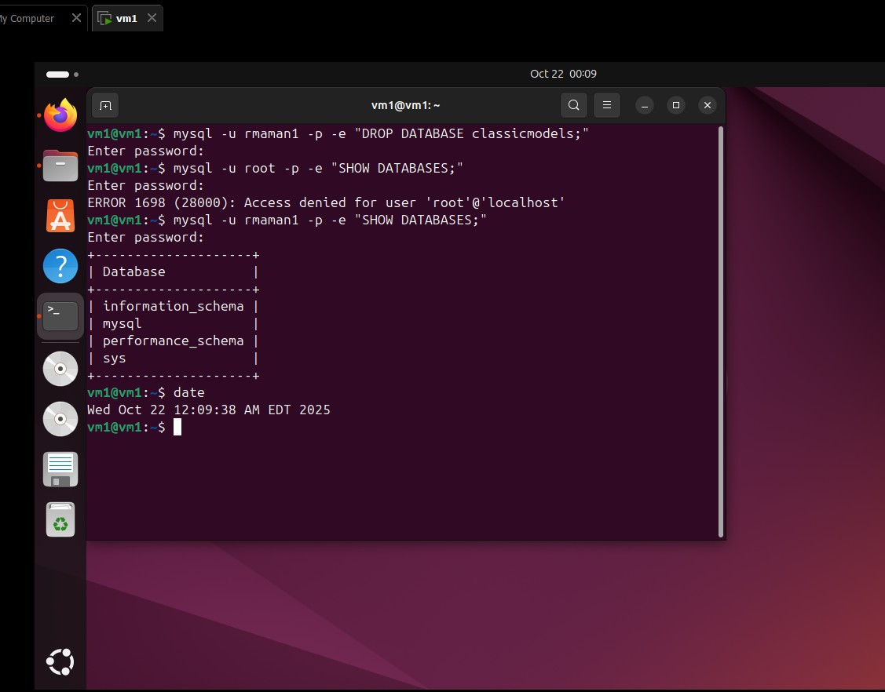
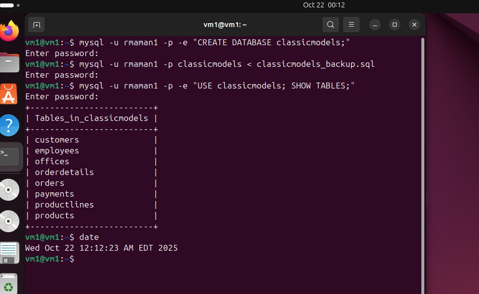
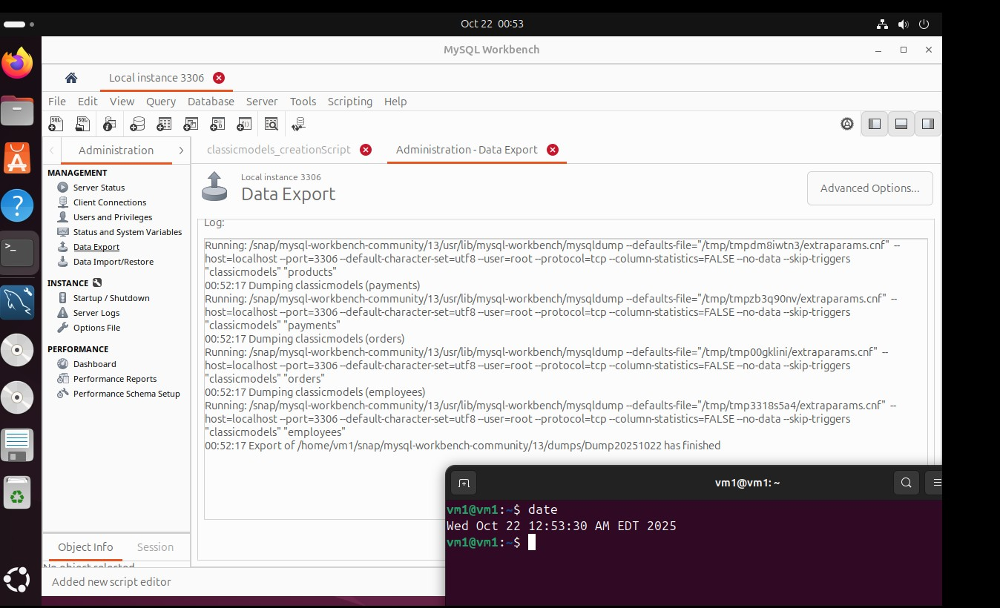
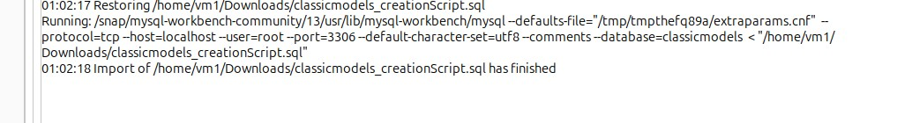
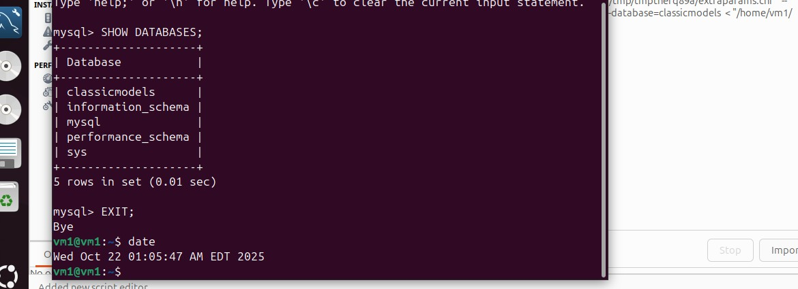
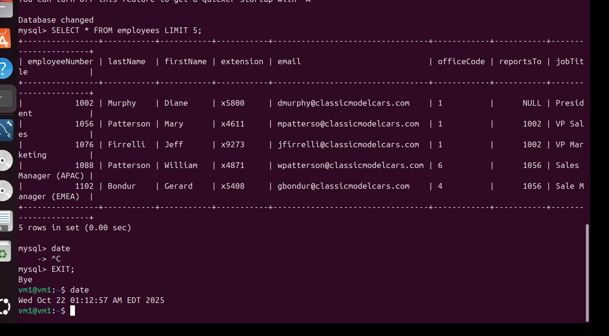
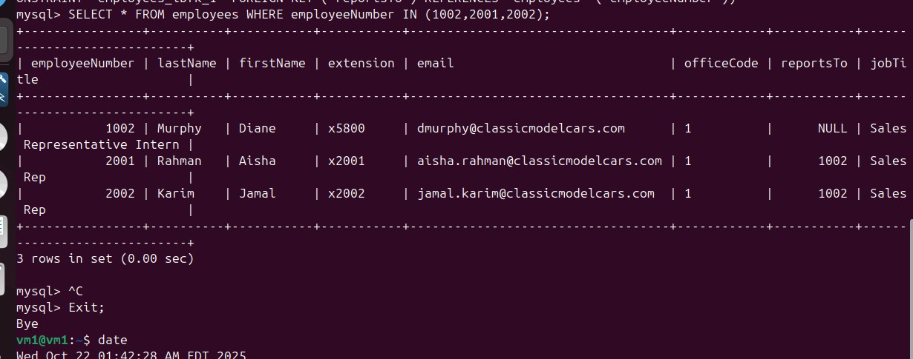

# Lab 5 — Database Backup and Recovery

**Author:** Rabbi Muhammad Aman · **Course:** RIS330 (Fall 2025)

## Objective

Back up and restore a MySQL database (`classicmodels`) three ways: logical dumps with `mysqldump`, MySQL Workbench export/import, and point-in-time recovery from the binary log.

## Activity 1 — mysqldump

*`mysqldump classicmodels > classicmodels_backup.sql`*

*Database dropped*

*Database restored from the dump*

## Activity 2 — MySQL Workbench

*Server → Data Export*

*`DROP DATABASE classicmodels;`*

*Server → Data Import*

*Database restored*

## Activity 3 — Binary log recovery

*Binary logging enabled in `mysqld.cnf` (`log_bin`, `binlog_format = ROW`)*

*Tables before changes*

*After changes*

*`employees` table dropped (with `FOREIGN_KEY_CHECKS` temporarily off)*

*Table recovered by replaying the log: `mysqlbinlog mysql-bin.000001 | mysql -u root -p`*

## Key takeaways

- Logical dumps are portable but only as fresh as the last backup.
- Binary logs give point-in-time recovery: every change after the backup can be replayed.
- Backups only count once a restore has been tested.
