# Lab 7 — NoSQL with MongoDB

**Author:** Rabbi Muhammad Aman · **Course:** RIS330 (Fall 2025)

## Objective

Import a JSON movie dataset into MongoDB and answer questions with find and aggregation queries.

## Sample data

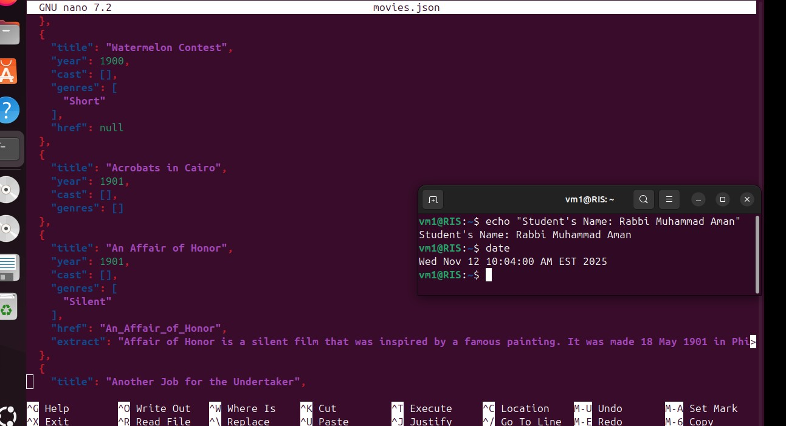
*Sample documents (1/7)*

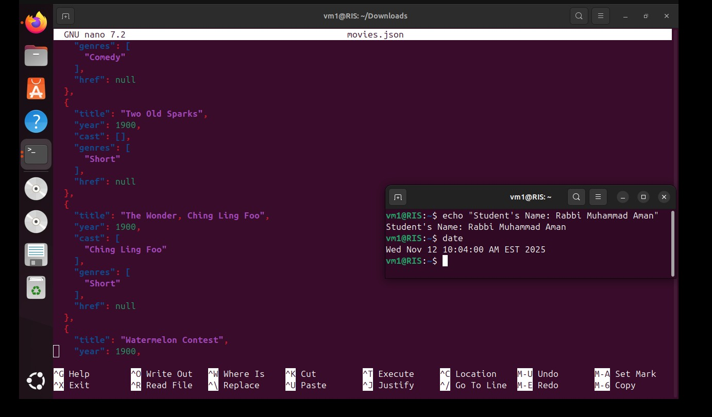
*Sample documents (2/7)*

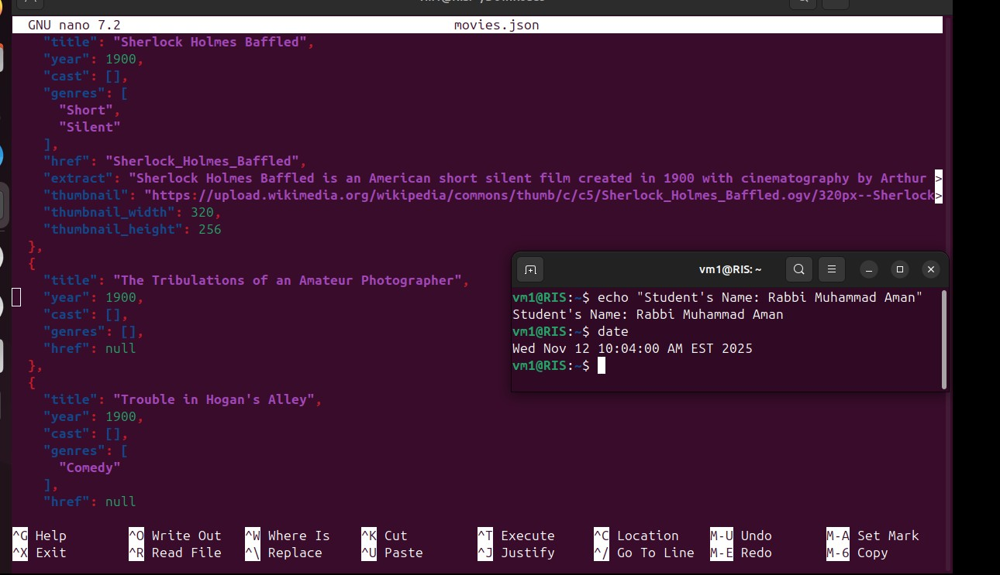
*Sample documents (3/7)*

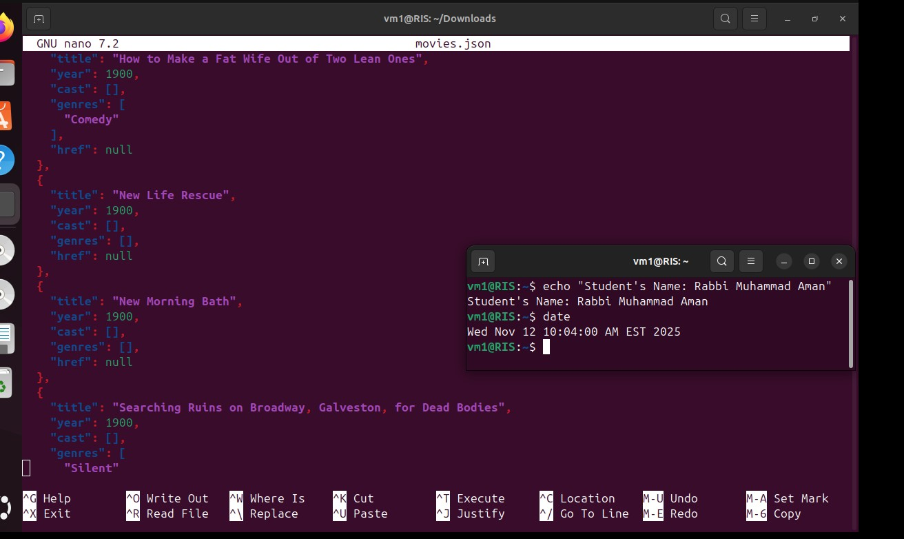
*Sample documents (4/7)*

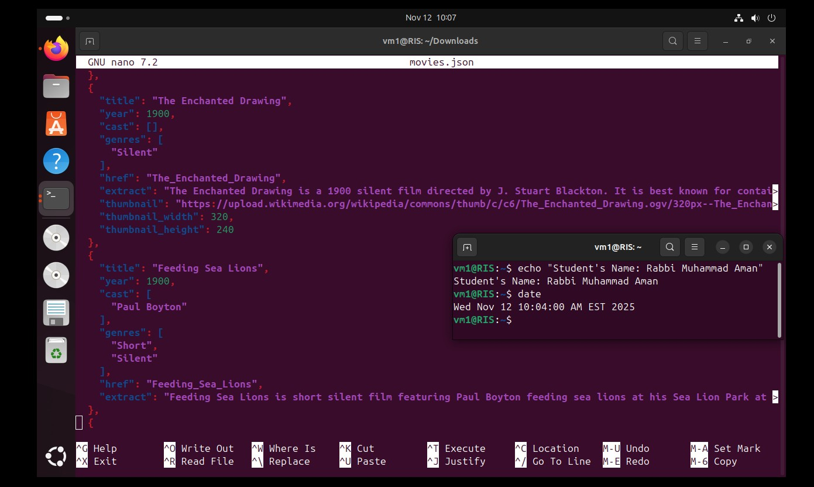
*Sample documents (5/7)*

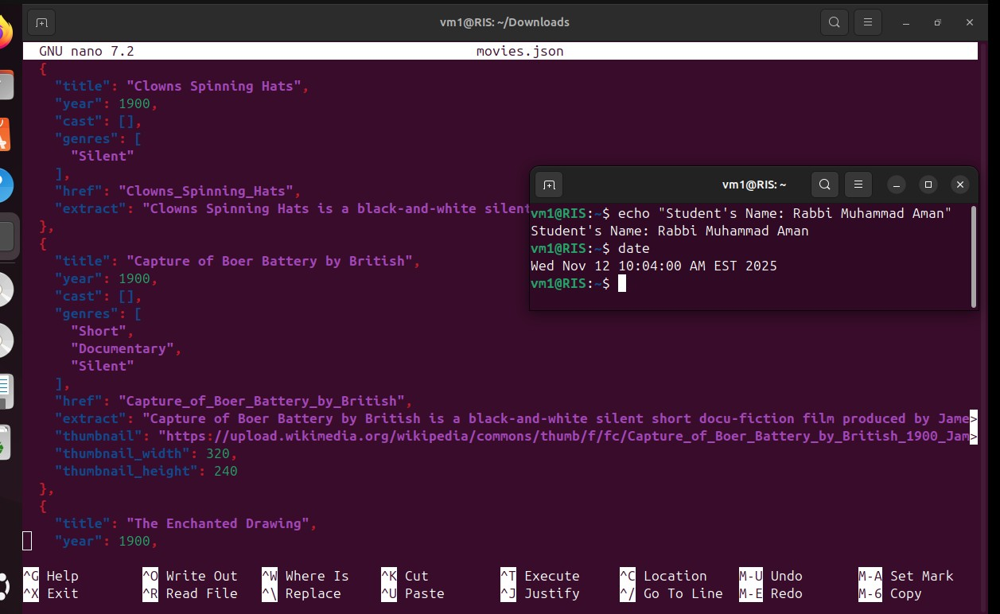
*Sample documents (6/7)*

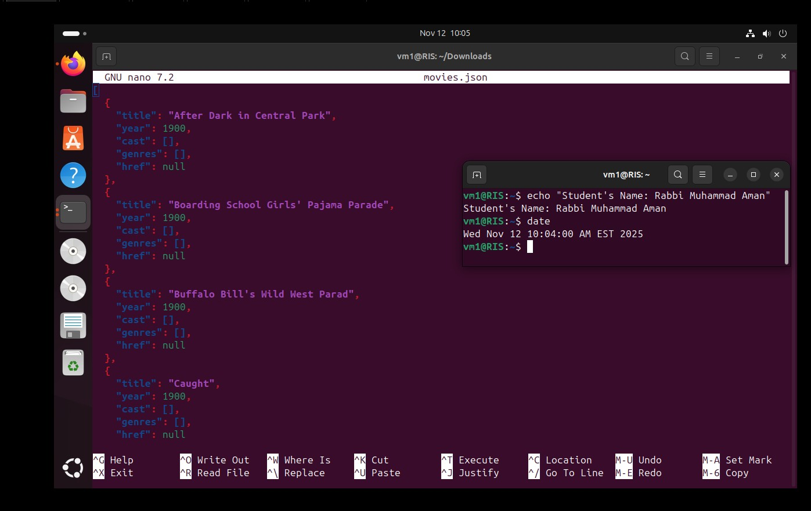
*Sample documents (7/7)*

## Import

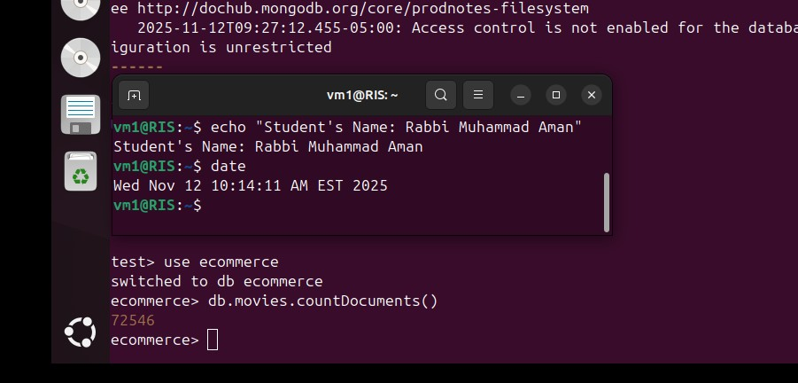
*Dataset imported with mongoimport*

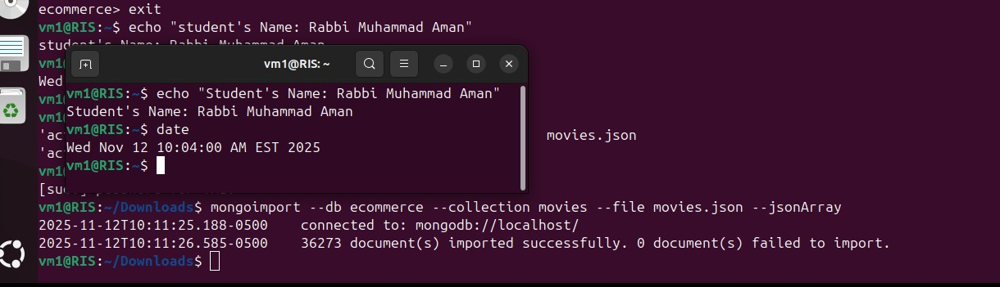
*Imported collection*

## Queries

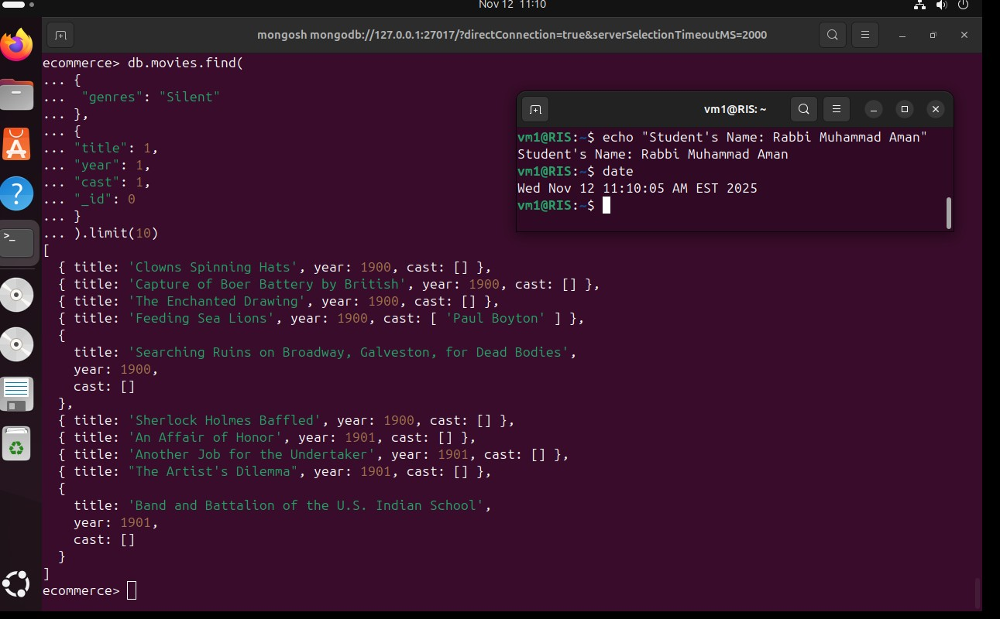
*Ten Silent-genre films with title, year and cast*

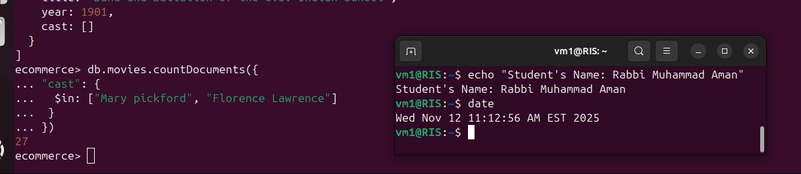
*Count of films featuring Mary Pickford or Florence Lawrence*

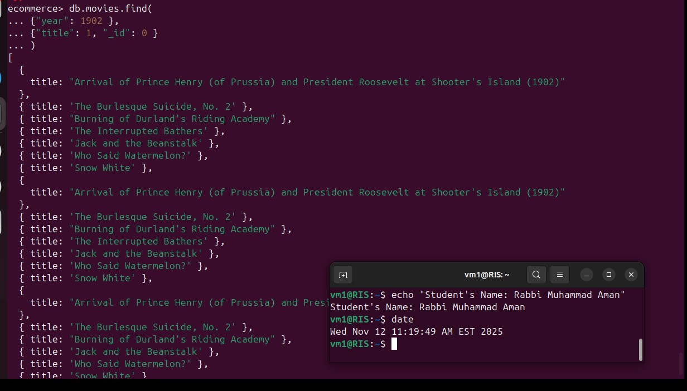
*Titles of films released in 1902*

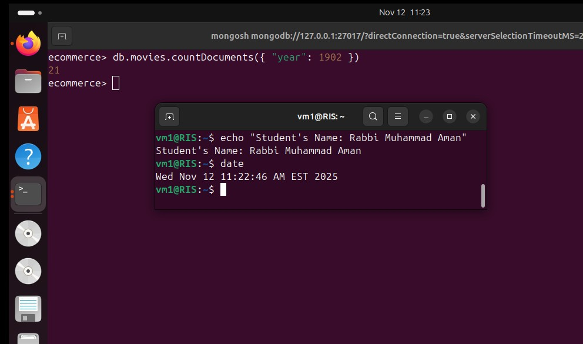
*Count of films released in 1902*

## Key takeaways

- Document databases store nested, schema-flexible data such as cast arrays.
- Projection and filters on array fields replace SQL joins.
