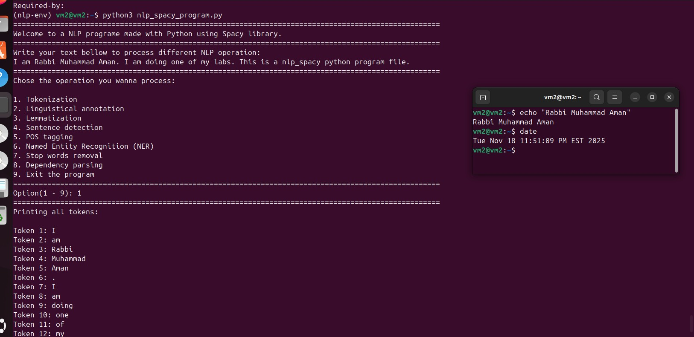
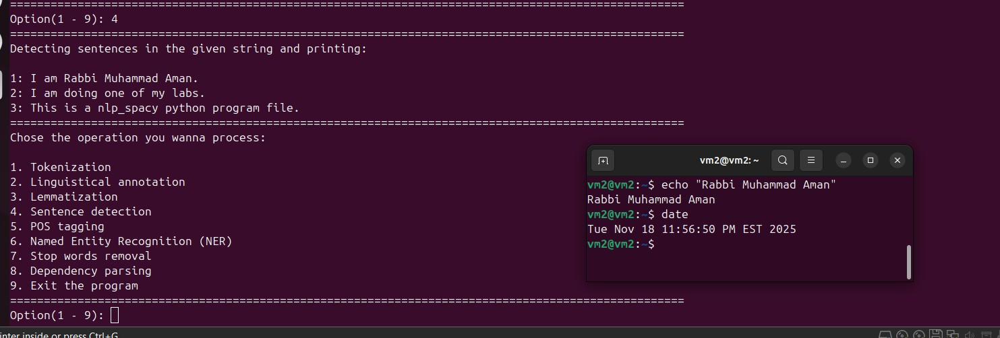
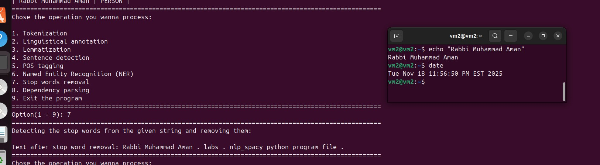
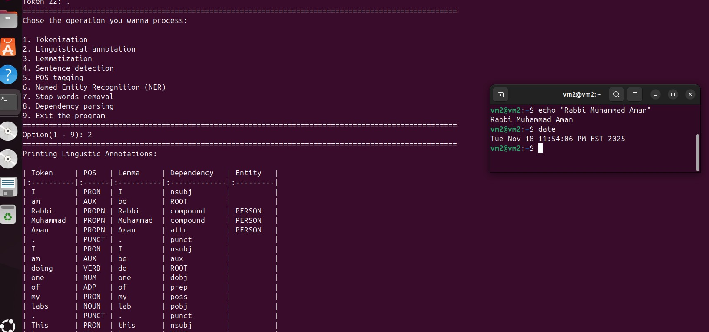
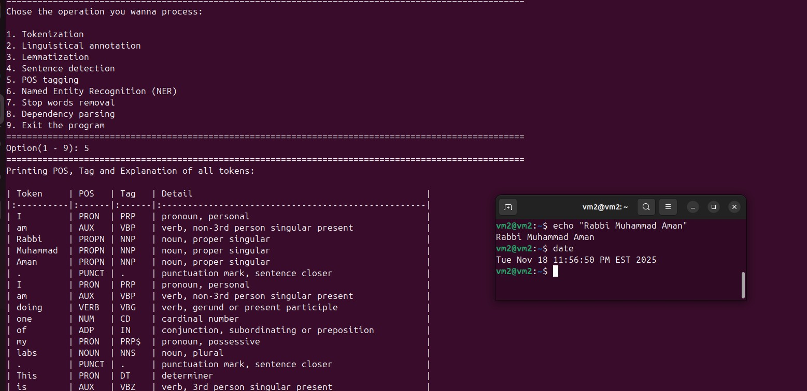
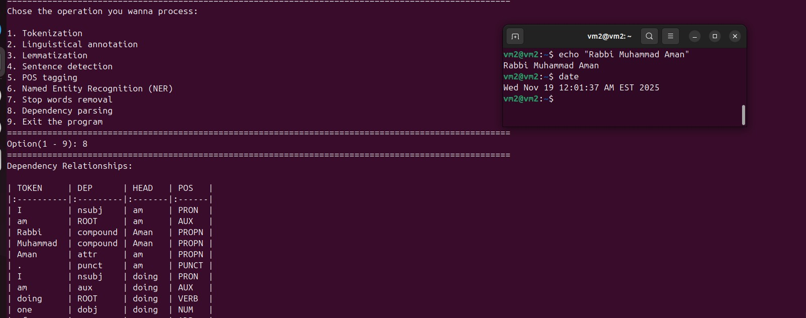
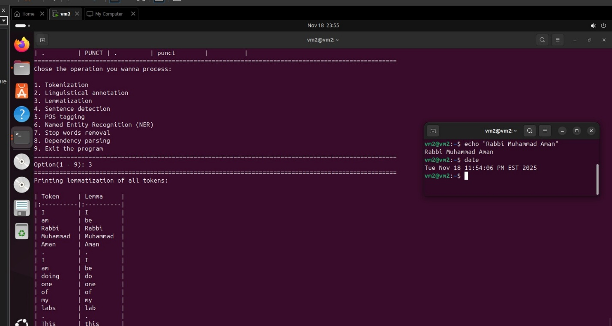
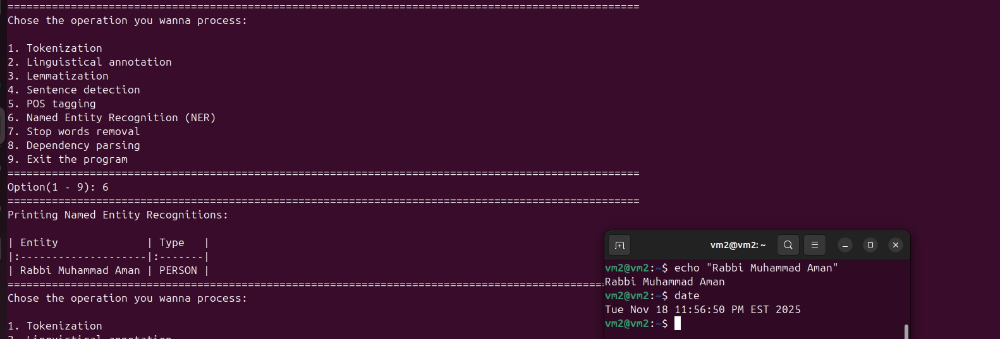

# Lab 8 — Natural Language Processing with spaCy

**Author:** Rabbi Muhammad Aman · **Course:** RIS330 (Fall 2025)

## Objective

An interactive Python program that runs the core NLP pipeline on user input and prints formatted tables.

## Pipeline output


*Tokenization*


*Sentence detection*


*Stop-word removal*


*Linguistic annotation*


*Part-of-speech tagging*


*Dependency parsing*


*Lemmatization*


*Named entity recognition*

Source code: [`nlp_spacy_program.py`](nlp_spacy_program.py)

```bash
pip install spacy tabulate
python -m spacy download en_core_web_sm
python nlp_spacy_program.py
```

## Key takeaways

- NLP is used in security for phishing detection, log triage and threat-intel extraction (NER for IPs, organizations, malware names).
